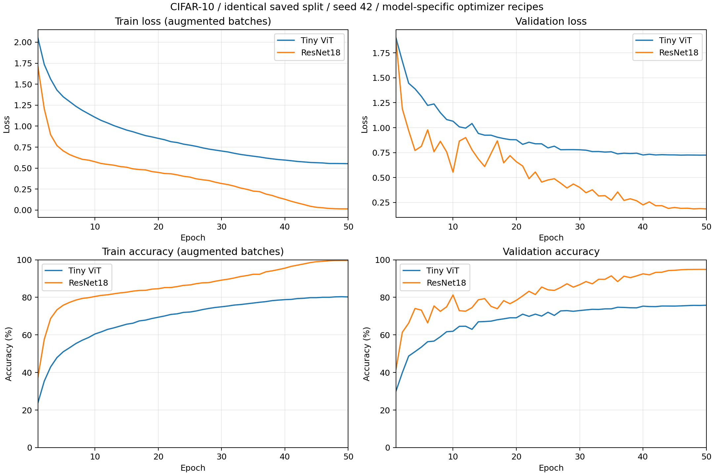
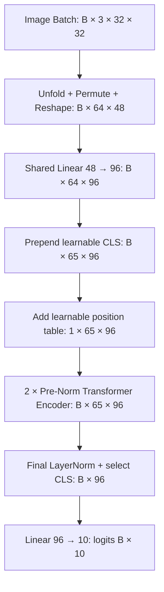

# Vision Transformer：从核心实现到 CIFAR-10 实验

一个独立的 PyTorch 视觉学习与工程实践项目：显式实现 Patch Embedding、缩放点积注意力、多头注意力和 Pre-Norm Encoder，组合成可配置的小型 ViT，再完成 CIFAR-10 真实训练及 ResNet18 实用对照。

项目采用 AI 辅助工程协作，保留逐模块实现、数值检查和实验记录。当前已完成核心实现、两轮 50 Epoch 基线训练、对照分析及作品集整理。

**所有准确率均来自固定验证集，不是 CIFAR-10 官方测试集成绩。两种模型使用不同优化配方，结果不构成纯架构消融。**

> **English summary.** This project implements a compact Vision Transformer in PyTorch with explicit tensor reshaping and attention operations. A 50-epoch CIFAR-10 experiment reaches 75.80% validation accuracy; a CIFAR-adapted ResNet18 reaches 94.88% on the identical saved split. The models use different capacities and optimizer recipes, so this is a practical baseline comparison rather than an architecture-only ablation. The official test set was not evaluated.

## 结果概览

两轮均从官方 50,000 张训练图像中划分 45,000 / 5,000，Batch=64、seed=42、50 Epoch。ResNet18 直接读取 ViT 保存的索引文件，两个原始索引文件逐字节一致。

| 项目 | Tiny ViT | CIFAR-10 ResNet18 |
| --- | --- | --- |
| 参数量 | 235,882 | 11,173,962 |
| 初始化 | 随机初始化 | `torchvision.models.resnet18(weights=None)` |
| 优化器 | AdamW | SGD，Momentum=0.9 |
| 初始 LR / Weight Decay | 3e-4 / 0.05 | 0.1 / 5e-4 |
| 学习率调度 | 5 Epoch Warmup + Cosine | 5 Epoch Warmup + Cosine |
| 最低 LR | 1e-6 | 1e-5 |
| 最佳验证准确率 | **75.80%** | **94.88%** |
| 首次最佳 Epoch | 50 | 49（50 持平） |
| 最低验证 Loss | 0.724437，Epoch 49 | 0.185998，Epoch 50 |
| 最终 Train / Validation Accuracy | 80.20% / 75.80% | 99.62% / 94.88% |
| 实测训练耗时，含验证等 | 17 分 44 秒 | 36 分 23 秒 |



ResNet18 的最佳验证准确率高 19.08 个百分点，但其参数量约为 47.37 倍，优化器、正则化和计算成本也不同。Tiny ViT 后期接近平台；ResNet18 早期验证波动较大，后期继续改善。两者最终训练—验证准确率差分别约为 4.40 / 4.74 个百分点，未观察到验证持续恶化的明显严重过拟合。

完整精度的 [ViT 指标](results/tiny_vit/metrics.csv)、[ResNet18 指标](results/resnet18/metrics.csv)、[对照摘要](results/comparison/summary.json) 和 [结果说明](results/README.md) 随仓库提供。模型权重与完整数据集保留在本地，不纳入公开文件。

## ViT 数据流与实现

本项目的 Tiny ViT 指以下自定义轻量配置：`image_size=32, patch_size=4, in_channels=3, embed_dim=96, num_heads=4, depth=2, mlp_ratio=4, num_classes=10`，实测 **235,882** 个可训练参数。



| 模块 | 真实实现与关键行为 | 文件 |
| --- | --- | --- |
| Patch Embedding | 非重叠 `unfold`；按行组织 Patch；同一个 Linear 映射最后一维。32/4 配置中有 64 个 Patch，每个含 `3×4×4=48` 个输入特征 | [Unit 01 演示](unit01_patch_embedding.py)、[可复用输入模块](unit04_position_embedding.py) |
| Self-Attention | `softmax(Q @ K.transpose(-2,-1) / sqrt(d_k), dim=-1) @ V`，Batch 保持独立 | [Unit 02](unit02_scaled_dot_product_attention.py) |
| Multi-Head Attention | `[B,N,D] → [B,N,H,d] → [B,H,N,d]`；各 Head 独立计算；合并前先 permute，再 reshape，最后执行输出投影 | [Unit 03](unit03_multi_head_attention.py) |
| CLS / Position Embedding | 两个 `nn.Parameter`；CLS 经 expand 后拼到索引 0；位置表沿 Batch 广播，包含 CLS 位置 | [Unit 04](unit04_position_embedding.py) |
| Encoder | Pre-Norm、两个残差、MLP `D → 4D → D`，激活 GELU；不改变 `[B,N,D]` | [Unit 05](unit05_transformer_encoder.py) |
| 分类模型 | 输入序列 → Encoder 堆叠 → 最终 LayerNorm → CLS 提取 → 10 类原始 Logits | [Unit 06](unit06_vision_transformer.py) |

Encoder 的实际核心顺序：

```python
x = x + self.attention(self.norm1(x))
x = x + self.mlp(self.norm2(x))
```

Unit 01 的独立演示使用 48×48 / Patch 6，因此展平特征为 108；完整模型的默认 32×32 / Patch 4 使用 48。完整 ViT 也支持通过初始化参数选择 48/6，位置表尺寸随配置确定，不包含运行时任意分辨率插值。

## 工程验证与实验方法

已完成的工程记录包括 Patch 内容 / 顺序核对、Head 合并数值反例、Batch 隔离、Softmax 行归一化、可学习参数梯度、Encoder 残差及同权重参考计算、完整分类前向 / 反向检查，以及训练管线保存 / 加载检查。

两次正式训练均通过第 1、3 Epoch 健康检查，完成 50 Epoch 且无中断恢复。每 Epoch 记录样本加权的训练 / 验证 Loss、Accuracy、最后一个训练 Batch 的 LR 和耗时；以验证准确率选 best，并保存 last。准确率相同不覆盖旧 best，因此 ResNet18 的 best 是 Epoch 49，last 是 Epoch 50。

数据增强仅用于训练：`RandomCrop(32,padding=4) → RandomHorizontalFlip → ToTensor → Normalize`。验证仅 `ToTensor → Normalize`。固定 mean=`(0.4914,0.4822,0.4465)`、std=`(0.2470,0.2435,0.2616)`。官方测试集未用于调参、模型选择或评估。

ResNet18 保留标准残差块 `[2,2,2,2]`，将 stem 改为 3×3 / stride 1 / padding 1，MaxPool 改为 Identity，分类头改为 10 类。

## 环境、安装与运行

两轮训练实测环境：Windows、Python **3.10.20**、PyTorch **2.13.0+cu130**、torchvision 运行时 **0.28.0+cpu**、RTX 5060 Laptop GPU。NumPy **2.2.6**、Pillow **12.3.0**、Matplotlib **3.10.9**。完整记录见 [environment.json](results/environment.json)。

已有环境可直接使用。新环境请先根据 [PyTorch 官方安装说明](https://pytorch.org/get-started/locally/) 选择适合系统与设备的 PyTorch / torchvision 二进制，再应用 [requirements.txt](requirements.txt) 的直接依赖约束并执行 `python -m pip check`。requirements 不指定 CUDA 下载源，也不是跨平台锁文件；本次核对了本机依赖关系和版本索引，没有新建环境或重放安装。

以下 PowerShell 示例在项目根目录执行。`$python` 的写法对应本机已有 Conda 环境，其他机器应改成自己的解释器；`$dataRoot` 指向已经解压的 CIFAR-10 Python 数据根目录。

```powershell
$python = Join-Path $env:USERPROFILE 'anaconda3\envs\pytorch_dev\python.exe'
$dataRoot = 'E:\CIFAR-10\data'

# 只读验收公开产物，不读取数据集、不启动训练
& $python -X utf8 -B scripts/verify_portfolio.py --check-environment --check-models

# 查看已有入口实际支持的参数
& $python -X utf8 -B train_cifar10_vit.py --help
& $python -X utf8 -B train_cifar10_resnet18.py --help
```

公开产物验收会校验 SHA256、50 Epoch 指标、保存索引、对照结果和文档链接；`--check-models` 仅在 CPU 初始化模型并核对结构 / 参数量，不训练模型。

以下命令是使用已有入口的**显式复现训练命令**。它们会产生真实计算和新输出；任务 013 未执行这些命令重训。两个输出目录必须尚不存在。

```powershell
& $python -X utf8 -B train_cifar10_vit.py --train --device cuda --data-root $dataRoot --output-dir outputs/reproduce_vit_seed42 --image-size 32 --patch-size 4 --embed-dim 96 --num-heads 4 --depth 2 --mlp-ratio 4 --batch-size 64 --epochs 50 --lr 3e-4 --weight-decay 0.05 --warmup-epochs 5 --min-lr 1e-6 --seed 42 --val-size 5000 --num-workers 0

& $python -X utf8 -B train_cifar10_resnet18.py --train --device cuda --data-root $dataRoot --reference-dir results/tiny_vit --output-dir outputs/reproduce_resnet18_seed42 --batch-size 64 --epochs 50 --seed 42 --num-workers 0 --lr 0.1 --momentum 0.9 --weight-decay 5e-4 --warmup-epochs 5 --min-lr 1e-5
```

ViT 原入口按 seed=42 生成划分；复现完成后可用 `scripts/verify_portfolio.py --compare-split outputs/reproduce_vit_seed42/split_indices.json` 与已保存索引逐字节对照。ResNet18 的 `--reference-dir results/tiny_vit` 则直接读取仓库中的原索引和配置，无需被忽略的本机历史输出。更多数据准备、恢复训练与复核边界见 [复现说明](docs/reproducibility.md)。

## 仓库结构

```text
.
├── README.md
├── LICENSE
├── requirements.txt
├── .gitignore / .gitattributes
├── unit01_patch_embedding.py … unit06_vision_transformer.py
├── train_cifar10_vit.py
├── train_cifar10_resnet18.py
├── scripts/verify_portfolio.py
├── docs/
│   ├── reproducibility.md
│   └── release_check.md
├── results/
│   ├── README.md / manifest.json / environment.json
│   ├── tiny_vit/       # 配置、CSV、原始索引、曲线、摘要
│   ├── resnet18/       # 配置、CSV、曲线、摘要、运行计时
│   └── comparison/     # 并排曲线、比较 CSV / JSON、推理基准
└── outputs/            # 原始实验与权重保留本地，Git 忽略
```

本地的 AGENTS.md、PROJECT_HANDOFF.md 和 LEARNING_LOG.md 用于协作与学习记录，默认不纳入公开清单。公开结果副本只替换机器专属路径，指标和数值配置保持真实；逐文件来源及 SHA256 见 [manifest.json](results/manifest.json)。

## 实验限制与后续方向

- 每种模型仅运行一个 seed，未报告均值、标准差或统计显著性；验证结果不能替代官方测试集结论。
- 两种模型容量、优化器、LR / Weight Decay 和实际训练计算量不同。后续可以分别研究配方、容量或匹配预算，但本仓库当前没有执行这些额外实验。
- 两轮随机增强规则一致，训练中的逐次随机视图不作为完全相同的控制变量；最佳准确率的差异不能唯一确定改进原因。
- 固定图像 / Patch 配置对应固定位置表；当前没有位置插值、预训练迁移、分布式训练或通用部署接口。
- 原始脚本保留本机默认路径，外部复现应显式传入数据和参考目录。硬件与依赖构建变化可能导致数值和耗时差异，未在全新机器上重训验证。
- 原始权重不随仓库发布；不能在只克隆代码和轻量结果后直接恢复本地训练 Checkpoint。

本项目代码采用 [MIT License](LICENSE)。仓库不分发 CIFAR-10 数据集；数据来源和引用见下方参考资料。公开文件范围与发布检查说明见 [发布验收说明](docs/release_check.md)。

## 参考资料

- [An Image is Worth 16x16 Words: Transformers for Image Recognition at Scale](https://arxiv.org/abs/2010.11929)：ViT 原论文，项目模型为自定义轻量配置。
- [torchvision ResNet18 文档](https://docs.pytorch.org/vision/stable/models/generated/torchvision.models.resnet18.html)：对照模型 API；本项目设置 `weights=None`。
- [CIFAR-10 官方页面](https://www.cs.toronto.edu/~kriz/cifar.html)：数据来源与技术报告；仓库不分发数据集。
